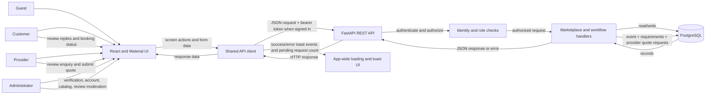
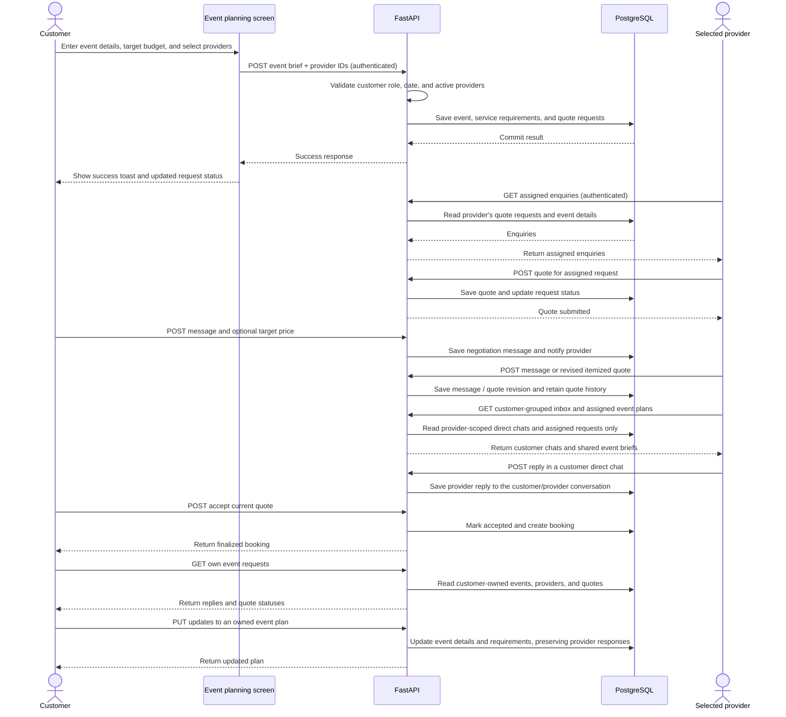

# EventHub Product and Feature Specification

**Status:** Current local MVP  
**Scope:** Event-services marketplace for customers and providers in India  
**Source of truth:** This document describes observable behavior represented in the current repository. Where behavior is planned but not implemented, it is explicitly labeled.

## Product purpose

EventHub helps customers plan celebrations, discover event-service providers, request and compare quotes, and track bookings. Providers can publish a service profile, respond to enquiries, and manage bookings. Administrators moderate provider access and marketplace content.

## Actors and permissions

| Actor | Capabilities |
|---|---|
| Guest | Browse public pages, providers, public profiles, Help, and About; create an account or sign in. |
| Customer | Manage account/settings; create an event brief; select providers for quotes; manage a provider shortlist and comments; rate and review providers. |
| Provider | Manage a provider profile and availability; view assigned enquiries; submit quotes; update bookings; customers who add a provider profile retain customer planning capabilities. |
| Administrator | Review provider verification; enable/disable customer and provider accounts; manage service categories and services; moderate reported reviews; view summary data. |

## Feature requirements

### Accounts, identity, and settings

- **REQ-001 (P1):** A guest can create an account with a unique email, contact details, and a customer or provider role. Passwords are stored as password hashes, not plaintext.
- **REQ-002 (P1):** A registered user can sign in; disabled accounts are denied access.
- **REQ-003 (P2):** A signed-in user can view and update their profile and notification preferences, and change their password after providing the current password.
- **REQ-004 (P2):** A customer can add a provider profile to their existing account and retain customer capabilities. The new provider profile starts pending verification.
- **REQ-005 (P2):** Providers can edit their public business identity, service/category, location, service radius, experience, pricing and price unit, description, supported logo image, and social links. Saving profile changes persists the fields and returns the listing to pending verification.

### Provider discovery and customer planning

- **REQ-006 (P1):** A visitor can browse active provider profiles and filter/search by service, location, and provider details.
- **REQ-007 (P1):** A customer can create an event brief with event type/date, location, guest count, optional budget, requested services, venue, and additional notes.
- **REQ-008 (P1):** A customer must select at least one active provider before submitting an event request. The customer experience blocks submission when none is selected; the API rejects past event dates and unavailable selected providers.
- **REQ-009 (P1):** A provider can view only enquiries assigned to their provider profile and submit a quote for an assigned request.
- **REQ-010 (P1):** A customer can retrieve their event requests and see the associated providers, request status, and submitted quotes.
- **REQ-011 (P2):** A customer can add providers to a shortlist, edit shortlist notes, select a final provider, restore shortlist status, and remove providers.
- **REQ-012 (P1):** A customer and the assigned provider can exchange messages and price proposals on an event request; providers can revise itemized quotes, and the customer can accept a quote to finalize it as a booking. The conversation, quote revisions, and request status remain visible to both parties.

### Provider operations and trust

- **REQ-012 (P2):** A provider can manage availability and update booking status using supported lifecycle states. A completed booking cannot be reverted.
- **REQ-013 (P2):** A customer can submit or update a 1–5-star provider rating with an optional comment. Public profile ratings and review counts reflect published reviews.
- **REQ-014 (P2):** A user can report a review; an administrator can publish, hide, or dismiss a report.
- **REQ-015 (P1):** An administrator can approve, reject, or return a provider for pending verification. Verification status is presented as a platform review status, not a guarantee of service quality.
- **REQ-016 (P1):** An administrator can enable or disable customer/provider accounts. Disabled provider listings are excluded from public discovery.
- **REQ-017 (P2):** An administrator can add and activate/deactivate service categories and services and view marketplace summary counts.
- **REQ-022 (P1):** Administrators can search and filter customer/provider accounts, review account and provider profile details unavailable to normal users, and manage account access. Private contact and address data is served only by admin-authorized endpoints and is shown for legitimate operational use.

### Application feedback and navigation

- **REQ-018 (P2):** Navigation exposes relevant role-specific destinations and preserves guest access to public discovery, Help, and About.
- **REQ-019 (P2):** When an API request takes longer than a brief delay, the app shows a blocking loading indicator; it clears when outstanding requests finish.
- **REQ-020 (P2):** Successful write actions show a contextual toast. Failed writes continue to show an error to the user and do not display a success message.
- **REQ-021 (P2):** Event-planning and provider profile screens use the shared celebration theme, support narrow screens, and avoid nested scrolling where the page is intended to provide the single scroll surface.
- **REQ-023 (P2):** Support conversations scroll to the latest message when opened or refreshed. Signed-in customers and administrators see in-app alerts for incoming support messages and can enable a locally remembered sound notification; sound remains opt-in.
- **REQ-024 (P1):** Providers can use a customer-grouped inbox to read and reply to direct customer messages and review event plans explicitly shared with their provider profile. Each plan keeps its own quote negotiation thread; providers cannot access event plans not assigned to their profile.

## Core user scenarios and acceptance checks

### A. Customer requests provider quotes (P1)

1. **Given** a signed-in customer, **when** they enter valid event details, choose at least one active provider, and submit, **then** the event and provider-specific quote requests are saved.
2. **Given** a saved request, **when** the selected provider opens enquiries, **then** that provider sees the customer, date, location, guest count, requested services, budget, schedule, and notes in a readable event brief.
3. **Given** a provider has reviewed the event brief, **when** they submit a quote, **then** they can enter a price for each requested service, add extra service lines, and see the calculated total before sending.
4. **Given** a customer has sent an event request to multiple providers, **when** they open that event in the planner, **then** each provider has a separate message/price-negotiation action and private discussion; the customer can include a target price and each provider can respond independently with a quote or revised itemized offer.
5. **Given** a provider revises an itemized quote, **when** the customer returns to the request, **then** the current offer and prior quote revisions remain visible with the discussion status.
6. **Given** a customer accepts the current provider quote, **when** finalization succeeds, **then** the quote and request are marked accepted, a booking is created, and the discussion becomes read-only.
7. **Given** the event date is in the past or no provider is selected, **when** the customer submits, **then** the past date is rejected by the API or the form blocks submission, a clear error is shown, and no successful-request toast appears.

### B. Provider onboarding and verification (P1)

1. **Given** a new provider, **when** they create an account and complete provider details, **then** a provider profile is created with pending verification.
2. **Given** an existing customer, **when** they add a provider profile, **then** their customer planning access remains available and their role includes provider access.
3. **Given** an administrator, **when** they approve or reject a provider, **then** the verification state is saved and reflected in provider data.
4. **Given** a provider editing their listing, **when** they update profile details and save, **then** the updated fields persist, the user receives save feedback, and the listing returns to pending verification.

### C. Provider customer inbox (P1)

1. **Given** a provider has direct messages or assigned event requests from multiple customers, **when** they open Messages, **then** each customer appears once and selecting them shows their direct chat and every event plan shared with that provider.
2. **Given** a provider is viewing a customer's event plans, **when** they review an event, **then** they can see its type, date, location, guest count, target budget, requested services, and customer notes, and can open that event's own quote conversation.
3. **Given** a customer sent a direct message, **when** the provider replies in the inbox, **then** the reply is stored in the same customer/provider chat and appears in the customer's provider chat.
4. **Given** a customer has other event plans that were not sent to this provider, **when** the provider opens the inbox, **then** those plans and their details are not returned or shown.

### D. Discovery, shortlist, and selection (P1)

1. **Given** a visitor, **when** they filter providers by location or service, **then** only matching active providers appear.
2. **Given** a customer, **when** they save a provider, note, or final choice, **then** the shortlist reflects the change after reload.
3. **Given** a selected final provider, **when** the customer selects a different provider, **then** the previous choice returns to shortlisted status.

### E. Reviews and moderation (P2)

1. **Given** a customer on a provider profile, **when** they choose a star value and submit a comment, **then** the review is saved and appears in the public review list.
2. **Given** a reported review, **when** an administrator hides or dismisses it, **then** the review is no longer exposed as a reported item and public rating totals reflect publication state.

### F. Account feedback (P2)

1. **Given** any API request remains pending beyond the loading delay, **when** it completes, **then** the app-wide loading indicator appears and then clears.
2. **Given** a successful write, **when** the server confirms it, **then** one contextual success toast is shown.
3. **Given** a failed write, **when** the server returns an error or the request fails, **then** the user sees the failure and no success toast is emitted.

## Data flow diagram

### Event request lifecycle

Customers can view planned events and provider responses from the planner dashboard, edit an existing plan without changing its provider recipients, or create a separate new plan. Providers receive the submitted event brief in their enquiries and can respond with an itemized price for each requested service, additional service lines, a calculated total, and explanatory notes; customers can see the itemized breakdown alongside each provider response.

Each customer-provider request has a private negotiation thread. Customers can message the assigned provider and optionally include a target price; providers can reply in the thread and send revised service-by-service quotes. Both sides see prior messages and quote versions and the current negotiation status. The customer finalizes a provider offer with **Accept quote and finalize**, which creates a booking and locks that thread from further negotiation. The event's target budget is shared with selected providers as a starting point, not a binding offer.

The provider **Messages** inbox groups quick customer chats by customer. It also shows all event plans explicitly shared with that provider, including their event brief and a separate negotiation thread per assigned request. It does not expose a customer's event plans that were not sent to that provider.

Providers receive persistent in-app notifications when a customer newly shortlists their profile or sends them an event plan. The provider dashboard polls for new notifications, shows an unread count and alert, supports optional sound, and lets providers mark notifications as read.

## Key data entities

| Entity | Purpose and important relationships |
|---|---|
| User | Customer, provider, combined customer/provider, or admin identity; has profile, credentials, active state, and preferences. |
| Provider | A user's business/service profile; contains service, location, price, verification, social links, and rating summary. |
| Event | Customer-owned celebration brief with type, date, location, guest count, budget, and status. |
| Requirement | Service needs attached to an event; includes service name and details. |
| QuoteRequest | Connects an event and customer to one selected provider; tracks request status and provider-facing details. |
| Quote | Provider response to an assigned quote request; includes itemized service prices, their total, notes, and status. |
| QuoteNegotiationMessage | Customer/provider message on an assigned request; may include the customer's target price and forms the negotiation history. |
| SupportMessage | Direct customer/provider chat message; provider replies are stored in the same provider-scoped conversation. |
| Booking | Tracks an accepted quote and event through provider booking lifecycle states. |
| ProviderNotification | Persists a customer shortlist or event-plan notification for a provider, including read state. |
| PlannerShortlist | Connects a customer to a provider with notes and shortlisted/selected status. |
| Review | Customer rating/comment for a provider and optionally a completed booking; supports publication and report moderation. |
| Category and Service | Admin-managed service taxonomy used to organize offerings. |

## Non-functional requirements

- **NFR-001:** Private actions require authentication and role checks; users may access only their own profile, event requests, and shortlist data or provider-assigned enquiries.
- **NFR-002:** Passwords must never be returned in API responses or stored as plaintext.
- **NFR-003:** User-facing errors must be explicit; a failed request must not produce success-shaped UI feedback.
- **NFR-004:** Core pages must remain usable at narrow mobile widths and with keyboard navigation.
- **NFR-005:** Decorative motion must respect reduced-motion preferences.
- **NFR-006:** Public content must distinguish synthetic demo listings and avoid implying platform verification guarantees service quality.

## Out of scope / current limitations

- EventHub does not process payments or refunds in this local MVP.
- Email notification delivery is not enabled; provider enquiries are available in the dashboard.
- `email_verified` is represented in user data, but a verification-email workflow is not specified as implemented.
- The specification does not promise provider background checks or guarantee service quality.

## Success criteria

- **SC-001:** A customer can create an event request and select at least one provider without leaving the event-planning flow.
- **SC-002:** A provider can retrieve only assigned enquiries and submit a quote for an assigned request.
- **SC-003:** After a write succeeds, the user receives one success confirmation; after failure, no success confirmation is shown.
- **SC-004:** Customer shortlist, provider verification, and review moderation changes persist after a page reload.
- **SC-005:** All primary journeys above can be completed using keyboard interaction and at a 390px viewport without horizontal overflow.

## Repository map

- Frontend route/state composition: `frontend/src/App.tsx`
- Shared API client and request feedback events: `frontend/src/api/client.ts`
- Navigation: `frontend/src/components/AppNavigation.tsx`
- Event request journey: `frontend/src/pages/EventRequestPage.tsx`
- Marketplace and public provider profiles: `frontend/src/features/marketplace/`
- Customer shortlist: `frontend/src/features/customer/PlannerShortlist.tsx`
- Provider operations: `frontend/src/features/provider/`
- Admin operations: `frontend/src/features/admin/AdminDashboard.tsx`
- API, persistence models, validation, and role checks: `backend/app/main.py`
