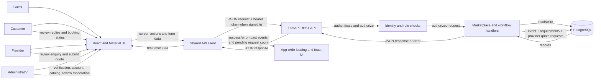
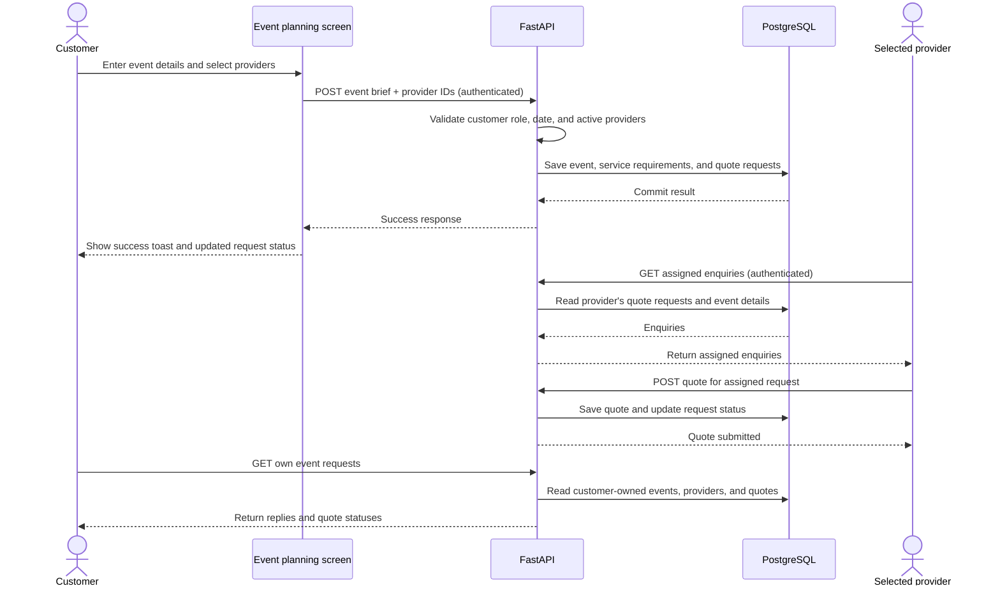

# EventHub Product and Feature Specification

**Status:** Current local MVP  
**Scope:** Event-services marketplace for customers and providers in India  
**Source of truth:** This document describes observable behavior represented in the current repository. Where behavior is planned but not implemented, it is explicitly labeled.

## Product purpose

EventHub helps customers plan celebrations, discover event-service providers, request and compare quotes, and track bookings. Providers can publish a service profile, respond to enquiries, and manage bookings. Administrators moderate provider access and marketplace content.

## Actors and permissions

| Actor | Capabilities |
|---|---|
| Guest | Browse public pages, providers, public profiles, Help, and About; create an account or sign in. |
| Customer | Manage account/settings; create an event brief; select providers for quotes; manage a provider shortlist and comments; rate and review providers. |
| Provider | Manage a provider profile and availability; view assigned enquiries; submit quotes; update bookings; customers who add a provider profile retain customer planning capabilities. |
| Administrator | Review provider verification; enable/disable customer and provider accounts; manage service categories and services; moderate reported reviews; view summary data. |

## Feature requirements

### Accounts, identity, and settings

- **REQ-001 (P1):** A guest can create an account with a unique email, contact details, and a customer or provider role. Passwords are stored as password hashes, not plaintext.
- **REQ-002 (P1):** A registered user can sign in; disabled accounts are denied access.
- **REQ-003 (P2):** A signed-in user can view and update their profile and notification preferences, and change their password after providing the current password.
- **REQ-004 (P2):** A customer can add a provider profile to their existing account and retain customer capabilities. The new provider profile starts pending verification.
- **REQ-005 (P2):** Providers can edit their public business identity, service/category, location, service radius, experience, pricing and price unit, description, supported logo image, and social links. Saving profile changes persists the fields and returns the listing to pending verification.

### Provider discovery and customer planning

- **REQ-006 (P1):** A visitor can browse active provider profiles and filter/search by service, location, and provider details.
- **REQ-007 (P1):** A customer can create an event brief with event type/date, location, guest count, optional budget, requested services, venue, and additional notes.
- **REQ-008 (P1):** A customer must select at least one active provider before submitting an event request. The customer experience blocks submission when none is selected; the API rejects past event dates and unavailable selected providers.
- **REQ-009 (P1):** A provider can view only enquiries assigned to their provider profile and submit a quote for an assigned request.
- **REQ-010 (P1):** A customer can retrieve their event requests and see the associated providers, request status, and submitted quotes.
- **REQ-011 (P2):** A customer can add providers to a shortlist, edit shortlist notes, select a final provider, restore shortlist status, and remove providers.

### Provider operations and trust

- **REQ-012 (P2):** A provider can manage availability and update booking status using supported lifecycle states. A completed booking cannot be reverted.
- **REQ-013 (P2):** A customer can submit or update a 1–5-star provider rating with an optional comment. Public profile ratings and review counts reflect published reviews.
- **REQ-014 (P2):** A user can report a review; an administrator can publish, hide, or dismiss a report.
- **REQ-015 (P1):** An administrator can approve, reject, or return a provider for pending verification. Verification status is presented as a platform review status, not a guarantee of service quality.
- **REQ-016 (P1):** An administrator can enable or disable customer/provider accounts. Disabled provider listings are excluded from public discovery.
- **REQ-017 (P2):** An administrator can add and activate/deactivate service categories and services and view marketplace summary counts.

### Application feedback and navigation

- **REQ-018 (P2):** Navigation exposes relevant role-specific destinations and preserves guest access to public discovery, Help, and About.
- **REQ-019 (P2):** When an API request takes longer than a brief delay, the app shows a blocking loading indicator; it clears when outstanding requests finish.
- **REQ-020 (P2):** Successful write actions show a contextual toast. Failed writes continue to show an error to the user and do not display a success message.
- **REQ-021 (P2):** Event-planning and provider profile screens use the shared celebration theme, support narrow screens, and avoid nested scrolling where the page is intended to provide the single scroll surface.

## Core user scenarios and acceptance checks

### A. Customer requests provider quotes (P1)

1. **Given** a signed-in customer, **when** they enter valid event details, choose at least one active provider, and submit, **then** the event and provider-specific quote requests are saved.
2. **Given** a saved request, **when** the selected provider opens enquiries, **then** that provider sees the event brief and can submit a quote.
3. **Given** a provider has submitted a quote, **when** the customer opens their event requests, **then** the provider response and quote status are visible.
4. **Given** the event date is in the past or no provider is selected, **when** the customer submits, **then** the past date is rejected by the API or the form blocks submission, a clear error is shown, and no successful-request toast appears.

### B. Provider onboarding and verification (P1)

1. **Given** a new provider, **when** they create an account and complete provider details, **then** a provider profile is created with pending verification.
2. **Given** an existing customer, **when** they add a provider profile, **then** their customer planning access remains available and their role includes provider access.
3. **Given** an administrator, **when** they approve or reject a provider, **then** the verification state is saved and reflected in provider data.
4. **Given** a provider editing their listing, **when** they update profile details and save, **then** the updated fields persist, the user receives save feedback, and the listing returns to pending verification.

### C. Discovery, shortlist, and selection (P1)

1. **Given** a visitor, **when** they filter providers by location or service, **then** only matching active providers appear.
2. **Given** a customer, **when** they save a provider, note, or final choice, **then** the shortlist reflects the change after reload.
3. **Given** a selected final provider, **when** the customer selects a different provider, **then** the previous choice returns to shortlisted status.

### D. Reviews and moderation (P2)

1. **Given** a customer on a provider profile, **when** they choose a star value and submit a comment, **then** the review is saved and appears in the public review list.
2. **Given** a reported review, **when** an administrator hides or dismisses it, **then** the review is no longer exposed as a reported item and public rating totals reflect publication state.

### E. Account feedback (P2)

1. **Given** any API request remains pending beyond the loading delay, **when** it completes, **then** the app-wide loading indicator appears and then clears.
2. **Given** a successful write, **when** the server confirms it, **then** one contextual success toast is shown.
3. **Given** a failed write, **when** the server returns an error or the request fails, **then** the user sees the failure and no success toast is emitted.

## Data flow diagram

### Event request lifecycle

## Key data entities

| Entity | Purpose and important relationships |
|---|---|
| User | Customer, provider, combined customer/provider, or admin identity; has profile, credentials, active state, and preferences. |
| Provider | A user's business/service profile; contains service, location, price, verification, social links, and rating summary. |
| Event | Customer-owned celebration brief with type, date, location, guest count, budget, and status. |
| Requirement | Service needs attached to an event; includes service name and details. |
| QuoteRequest | Connects an event and customer to one selected provider; tracks request status and provider-facing details. |
| Quote | Provider response to an assigned quote request; includes amount, unit, notes, and status. |
| Booking | Tracks an accepted quote and event through provider booking lifecycle states. |
| PlannerShortlist | Connects a customer to a provider with notes and shortlisted/selected status. |
| Review | Customer rating/comment for a provider and optionally a completed booking; supports publication and report moderation. |
| Category and Service | Admin-managed service taxonomy used to organize offerings. |

## Non-functional requirements

- **NFR-001:** Private actions require authentication and role checks; users may access only their own profile, event requests, and shortlist data or provider-assigned enquiries.
- **NFR-002:** Passwords must never be returned in API responses or stored as plaintext.
- **NFR-003:** User-facing errors must be explicit; a failed request must not produce success-shaped UI feedback.
- **NFR-004:** Core pages must remain usable at narrow mobile widths and with keyboard navigation.
- **NFR-005:** Decorative motion must respect reduced-motion preferences.
- **NFR-006:** Public content must distinguish synthetic demo listings and avoid implying platform verification guarantees service quality.

## Out of scope / current limitations

- EventHub does not process payments or refunds in this local MVP.
- Email notification delivery is not enabled; provider enquiries are available in the dashboard.
- `email_verified` is represented in user data, but a verification-email workflow is not specified as implemented.
- The specification does not promise provider background checks or guarantee service quality.

## Success criteria

- **SC-001:** A customer can create an event request and select at least one provider without leaving the event-planning flow.
- **SC-002:** A provider can retrieve only assigned enquiries and submit a quote for an assigned request.
- **SC-003:** After a write succeeds, the user receives one success confirmation; after failure, no success confirmation is shown.
- **SC-004:** Customer shortlist, provider verification, and review moderation changes persist after a page reload.
- **SC-005:** All primary journeys above can be completed using keyboard interaction and at a 390px viewport without horizontal overflow.

## Repository map

- Frontend route/state composition: `frontend/src/App.tsx`
- Shared API client and request feedback events: `frontend/src/api/client.ts`
- Navigation: `frontend/src/components/AppNavigation.tsx`
- Event request journey: `frontend/src/pages/EventRequestPage.tsx`
- Marketplace and public provider profiles: `frontend/src/features/marketplace/`
- Customer shortlist: `frontend/src/features/customer/PlannerShortlist.tsx`
- Provider operations: `frontend/src/features/provider/`
- Admin operations: `frontend/src/features/admin/AdminDashboard.tsx`
- API, persistence models, validation, and role checks: `backend/app/main.py`
